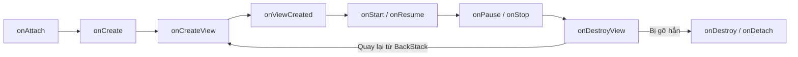

# INT4211 - LẬP TRÌNH TRÊN CÁC THIẾT BỊ DI ĐỘNG
## BÁO CÁO THỰC HÀNH LAB A8: GIAO DIỆN MODULAR VỚI FRAGMENT

---

### THÔNG TIN SINH VIÊN
* **Họ và tên:** Đỗ Lê Tuấn Đạt
* **Mã số sinh viên (MSSV):** 231A290089
* **Lớp học phần:** Lập trình thiết bị di động (INT4211)
* **Môi trường thực thi:** Android Studio trên macOS (Apple Silicon)
* **Thiết bị thử nghiệm:** Máy ảo Pixel 8 & Pixel Tablet (Android 17, API 37.1)

---

### CÁC MỤC ĐÃ HOÀN THÀNH

#### 1. Kiến trúc Single-Activity Multi-Fragment & BottomNavigationView (Phần 1, 2, 4)
* Sử dụng `FragmentContainerView` chuẩn hiện đại thay cho `FrameLayout` để đảm bảo xử lý chính xác vòng đời và `WindowInsets`.
* Thiết lập `BottomNavigationView` điều hướng mượt mà giữa 3 tab: **Trang chủ** (`HomeFragment`), **Tin tức** (`NewsListFragment`) và **Cá nhân** (`ProfileFragment`).
* Kiểm soát `if (savedInstanceState == null)` khi nạp tab mặc định để chống lỗi nạp chồng Fragment khi xoay màn hình.
* Các thao tác chuyển tab sử dụng `replace()` và không đẩy vào Back Stack giúp nút Back thoát ứng dụng tự nhiên.

#### 2. Truyền nhận dữ liệu hai chiều giữa các Fragment (Phần 3)
* **Chiều đi (Mẫu `newInstance` + `Bundle arguments`):** Đóng gói dữ liệu tiêu đề, nội dung bản tin và thông tin sinh viên (**Đỗ Lê Tuấn Đạt – 231A290089**) vào `arguments`. Đảm bảo Fragment giữ nguyên dữ liệu khi hệ thống tái tạo bằng constructor rỗng lúc xoay màn hình.
* **Chiều về (`Fragment Result API`):** Sử dụng `setFragmentResult` tại `NewsDetailFragment` và lắng nghe qua `setFragmentResultListener(..., getViewLifecycleOwner(), ...)` tại `NewsListFragment` để cập nhật trạng thái `"Đã đọc: ..."` an toàn khi View còn sống.

#### 3. Khảo nghiệm Vòng đời Fragment trên Logcat (Phần 1.1, 3.2, 6)

* Chứng minh thực nghiệm hiện tượng **Fragment sống lâu hơn View của nó**: Khi đẩy `NewsDetailFragment` vào Back Stack, `NewsListFragment` chỉ hủy tới `onDestroyView()`, khi nhấn Back quay lại thì chạy thẳng vào `onCreateView()` mà không gọi lại `onCreate()`.

#### 4. Bài nâng cao NC1: Bố cục Master-Detail cho Tablet (`res/layout-sw600dp/`)
* Xây dựng layout 2 khung ngang cho màn hình có bề rộng nhỏ nhất từ 600dp trở lên (`fragmentContainer` tỉ lệ 2 và `detailContainer` tỉ lệ 3).
* Tự động kiểm tra `findViewById(R.id.detailContainer) != null`: Trên điện thoại mở màn hình mới đẩy vào Back Stack; trên Tablet hiển thị nội dung chi tiết ngay ở cột bên phải.

#### 5. Bài nâng cao NC4: Hiệu ứng chuyển cảnh Fragment (`setCustomAnimations`)
* Tạo bộ 4 file hoạt họa trong `res/anim/` (`slide_in`, `slide_out`, `fade_in`, `fade_out`) và tích hợp vào `FragmentTransaction` khi chuyển tab cũng như khi đóng/mở chi tiết bản tin.
